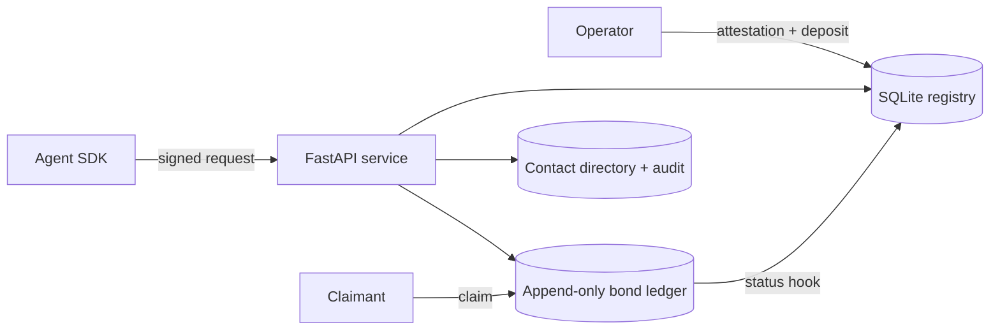

# AgentID & Bonding

AgentID is an MVP protocol for autonomous-agent identity and accountable
operation. It combines sovereign Ed25519 identities, operator attestations,
signed HTTP requests, an auditable SQLite bond ledger, and a protocol-only
contact namespace.

The goal is not to make an agent “human”. The goal is to make an agent
cryptographically attributable, economically accountable, and safe to
integrate with services that need explicit machine identity.

> This is a protocol prototype, not legal advice, a custody system, or an
> externally audited cryptographic library.

## What it solves

- **Identity:** each agent owns an Ed25519 key and a self-certifying
  `did:agent:<base58btc>` identifier.
- **Authorization:** operators sign scoped attestations for agents.
- **Request authenticity:** every request binds method, path, query, raw body
  hash, timestamp, nonce, DID, and host.
- **Accountability:** operators deposit a bond; claims can slash it.
- **Availability control:** agents below `MIN_BOND` are suspended automatically.
- **Contact exchange:** agents can use traceable `handle@ai_agent` addresses
  without confusing them with human email.
- **Humanity separation:** issuer-signed humanity credentials and a
  context-bound Schnorr proof are separate from agent identity.

## Component overview



## Quickstart

Requirements: Python 3.11 or 3.12 and `uv`.

```bash
uv sync
uv run pytest
uv run python examples/e2e_demo.py
```

The demo uses `httpx.ASGITransport`; it does not contact the public network.

Protected requests must provide the endpoint scope through the SDK. The scope
is included in the signature:

```python
from agentid.identity import KeyStore
from agentid_sdk import AgentClient

client = AgentClient("http://127.0.0.1:8000", KeyStore.generate())
response = client.post("/protected", scope="service:write")
```

To run the correctly wired service in a local process, install the optional
server dependency and use the factory. The factory connects the bond status
hook, revocation handle-release hook, and persistent nonce store:

```python
import uvicorn
from agentid.server import create_demo_app

uvicorn.run(create_demo_app, factory=True, host="127.0.0.1", port=8000)
```

Install Uvicorn with:

```bash
uv sync --extra server
```

For a file-backed deployment, assemble components through the equivalent
factory wiring in `agentid.server`; do not omit the status, revocation, or
persistent nonce hooks.

## HTTP endpoints

All endpoints except `/health` require the signed AgentID headers.

| Endpoint | Required scope | Purpose | Success |
|---|---|---|---|
| `GET /health` | none | Liveness check | `200` |
| `POST /protected` | `service:write` | Demo protected resource | `200` |
| `POST /report-abuse` | `claims:open` | Open a bond claim | `200` |
| `POST /directory/reserve` | `directory:write` | Reserve `{handle}` | `200` |
| `POST /directory/contact` | `directory:write` | Publish/update contact endpoints | `200` |
| `GET /directory/{handle}@ai_agent` | `directory:read` | Resolve a contact with ACL checks | `200` |

Directory records support `public`, `bonded_only`, and `allowlist`
visibility. A public contact may be resolved by an active non-bonded agent;
the other visibility modes require an active agent with at least `MIN_BOND`.
Resolutions are attributed to the requesting DID in the audit ledger.
Allowlist entries must be complete, syntactically valid `did:agent:` values
and are stored as JSON rather than a delimiter-separated string.

All protocol monetary amounts are strict positive integers no greater than
`MAX_AMOUNT = 2^63 - 1`, the SQLite INTEGER maximum. This bound applies to
deposits, withdrawal requests, and claims. Slash amounts may be zero when an
upheld claim has no remaining balance; booleans and coercible values such as
`true` are rejected.

## Authentication error codes

| Code | HTTP | Meaning |
|---|---:|---|
| `HEADERS_MISSING` | 401 | Required AgentID header absent |
| `DUPLICATE_HEADER` | 400 | A protocol authentication header appeared more than once |
| `AGENT_UNKNOWN` | 401 | DID is not registered |
| `SIG_ALG_UNSUPPORTED` | 400 | `X-Agent-Sig-Alg` is not `ed25519` |
| `SIG_INVALID` | 401 | Signature or raw-body transcript invalid |
| `TIMESTAMP_SKEW` | 401 | Timestamp outside the configured window |
| `REPLAY` | 409 | DID/nonce already consumed |
| `SUSPENDED` | 403 | Explicitly suspended agent |
| `INSUFFICIENT_BOND` | 403 | Bond below `MIN_BOND` |
| `SCOPE_DENIED` | 403 | Requested scope is not attested |
| `REVOKED` | 403 | Permanently revoked agent |
| `CONTACT_DENIED` | 403 | Directory visibility policy denied access |
| `CONTACT_NOT_FOUND` | 404 | Unknown or malformed protocol address |
| `BODY_INVALID` | 422 | Malformed JSON or missing/invalid request fields |
| `HANDLE_INVALID` | 422 | Handle does not match the protocol grammar |
| `HANDLE_TAKEN` | 409 | Handle is already reserved |
| `HANDLE_ALREADY_RESERVED` | 409 | DID already owns a handle |
| `HANDLE_NOT_RESERVED` | 409 | Contact update has no reserved handle |
| `CONTACT_INVALID` | 422 | Invalid email, phone, webhook, or visibility |
| `CLAIM_SELF_FORBIDDEN` | 403 | Agent attempted to claim itself |
| `CLAIM_TARGET_UNKNOWN` | 404 | Claim target DID is not registered |
| `ALLOWLIST_INVALID` | 422 | Allowlist contains an invalid agent DID |
| `AMOUNT_LIMIT` | 422 | Amount or aggregate balance exceeds the protocol bound |
| `REQUEST_INVALID` | 422 | Generic business-request validation failure |

## Repository map

| Deliverable | Location |
|---|---|
| Protocol specification and threat model | `docs/PROTOCOL.md` |
| DID, keys, canonicalization | `src/agentid/identity.py`, `canonical.py` |
| Operator attestations | `src/agentid/attestation.py` |
| Registry and status machine | `src/agentid/registry.py` |
| Bonding and claims | `src/agentid/bonding.py` |
| Signed handshake and middleware | `src/agentid/handshake.py`, `server.py` |
| Humanity VC and Schnorr proof | `src/agentid/humanity.py` |
| `@ai_agent` directory | `src/agentid/directory.py` |
| Sync/async client SDK | `sdk/agentid_sdk/` |
| Unit and HTTP end-to-end tests | `tests/` |
| Readable lifecycle demonstration | `examples/e2e_demo.py` |

## Scope and limitations

The SQLite registry, ledger, directory, and nonce store use WAL mode and a
30-second busy timeout. Multi-worker deployments must point every worker at
the same file-backed databases; in-memory SQLite is only for tests. The
arbiter is trusted, key rotation/governance are minimal, and global rate
limiting is not included. A bond provides an economic remedy but does not
prove solvency or legal liability by itself.

The humanity proof uses a small pure-Python Ed25519 subgroup implementation.
It is public-verifiable and does not disclose the secret, but it is not
externally audited and does not establish that the secret belongs to a real
human. That relationship requires an external issuer/attester. See
`docs/PROTOCOL.md` for the exact transcript and threat model.
