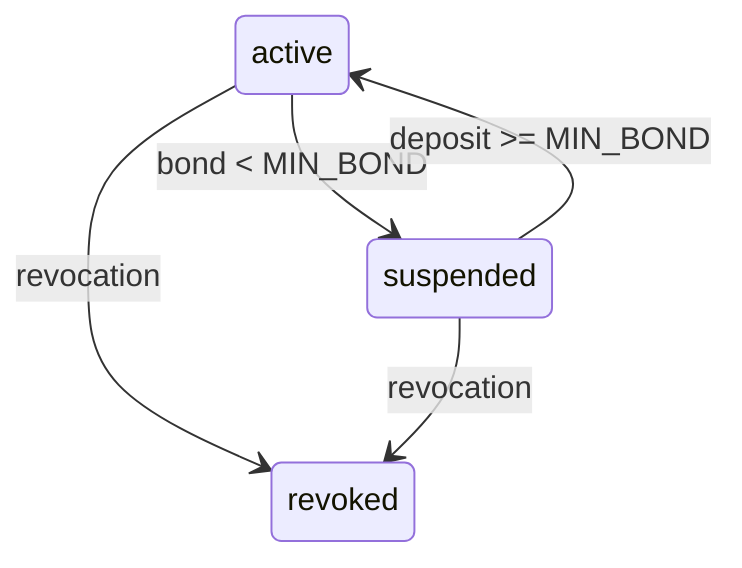
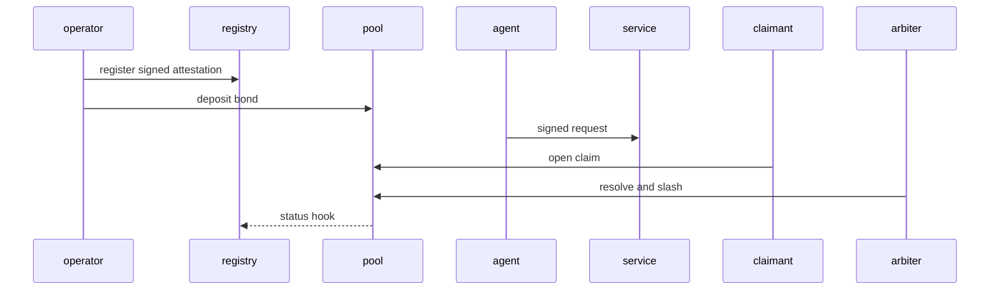

# AgentID & Bonding Protocol

## Identity and signing

`did:agent:<base58btc(ed01 || raw Ed25519 public key)>` is self-certifying and
can be resolved offline. The request signing string is the UTF-8 bytes of
canonical JSON (sorted keys, compact separators, no ASCII escaping):
`{"body_sha256":...,"did":...,"host":...,"method":...,"nonce":...,"path":...,"query":...,"scope":...,"timestamp":...}`.
Headers are `X-Agent-DID`, `X-Agent-Timestamp` (UTC RFC3339), `X-Agent-Nonce`,
`X-Agent-Signature` (base64), `X-Agent-Sig-Alg: ed25519`, and optional
`X-Agent-Scope`. The scope value, including its absence (`null`), is part of
the signed transcript. Endpoint scope requirements are server declarations:
`service:write` for `/protected`, `claims:open` for `/report-abuse`,
`directory:write` for reserve/publish, and `directory:read` for resolution.
An endpoint requiring a scope rejects a missing or unattested scope.
For example, an SDK client must call
`client.post("/protected", scope="service:write")`; omitting `scope` is
rejected with `SCOPE_DENIED`. Duplicate protocol headers, including duplicate
`X-Agent-Scope`, are rejected with `DUPLICATE_HEADER`.

The verifier requires one shared nonce store. The demo server uses
`SQLiteNonceStore`, which persists `(did, nonce, expiry)` and purges expired
rows; deployments with multiple workers must use a shared SQLite file or
another shared/distributed implementation. It verifies the signature before
consuming the nonce, so an invalid request cannot burn a legitimate agent's
nonce. The raw request bytes are hashed directly; JSON is never parsed and
re-dumped during verification.
Nonce consumption occurs only after signature, agent state, bond, and scope
authorization all succeed. A denied scope therefore does not burn a nonce.

Authentication errors use the following code/status mapping:

| Code | HTTP | Meaning |
|---|---:|---|
| `HEADERS_MISSING` | 401 | Required authentication header absent |
| `DUPLICATE_HEADER` | 400 | Protocol authentication header appeared more than once |
| `AGENT_UNKNOWN` | 401 | DID is not registered |
| `SIG_ALG_UNSUPPORTED` | 400 | Signature algorithm is not Ed25519 |
| `SIG_INVALID` | 401 | Signature does not verify |
| `TIMESTAMP_SKEW` | 401 | Timestamp is outside the accepted window |
| `REPLAY` | 409 | DID/nonce has already been consumed |
| `SUSPENDED` | 403 | Agent is explicitly suspended |
| `INSUFFICIENT_BOND` | 403 | Balance is below `MIN_BOND` |
| `SCOPE_DENIED` | 403 | Requested scope is not authorized |
| `REVOKED` | 403 | Agent is permanently revoked |
| `BODY_INVALID` | 422 | Malformed JSON or missing/invalid fields |
| `HANDLE_INVALID` | 422 | Handle does not match the protocol grammar |
| `HANDLE_TAKEN` | 409 | Handle is already reserved |
| `HANDLE_ALREADY_RESERVED` | 409 | DID already owns a handle |
| `HANDLE_NOT_RESERVED` | 409 | Contact update has no reserved handle |
| `CONTACT_INVALID` | 422 | Invalid contact endpoint or visibility |
| `CLAIM_SELF_FORBIDDEN` | 403 | Agent attempted to claim itself |
| `CLAIM_TARGET_UNKNOWN` | 404 | Claim target is not registered |
| `ALLOWLIST_INVALID` | 422 | Allowlist contains an invalid agent DID |
| `AMOUNT_LIMIT` | 422 | Amount or aggregate balance exceeds the protocol bound |
| `REQUEST_INVALID` | 422 | Generic business-request validation failure |

## State and bonding

Agents start `active`, become `suspended` when their balance falls below
`MIN_BOND`, and may be `revoked` permanently. Deposits and withdrawals are
append-only events; withdrawals have a cooldown. Claims are opened and an
arbiter can uphold them, creating slash and indemnity events.





## Contacts

`<handle>@ai_agent` is a non-routable protocol namespace, deliberately
distinct from human email. A handle is reserved by an active DID and contact
reads are ACL-controlled and audited. Bonding and attribution make bulk spam
costly and investigateable; this MVP does not provide global rate limiting.

The signed HTTP directory endpoints are:

- `POST /directory/reserve` with `{"handle":"..."}`;
- `POST /directory/contact` with email, webhook, optional E.164 phone,
  `visibility` (`public`, `bonded_only`, or `allowlist`) and an allowlist;
- `GET /directory/<handle>@ai_agent`.

Every request passes the normal AgentID middleware. Reserve/publish require an
active, sufficiently bonded requester. A public contact can be resolved by an
active non-bonded requester; `bonded_only` and `allowlist` require a bonded
requester. Every successful resolution writes `(requester_did, handle,
timestamp)` to the audit log. The service factory wires revocation to release
the reservation and bonding status changes to the registry.
Allowlist values are complete, syntactically valid `did:agent:` identifiers
and are serialized as JSON; delimiter characters cannot alter membership.

All monetary amounts are strict integers in the range `1..MAX_AMOUNT`, where
`MAX_AMOUNT = 2^63 - 1`, matching SQLite's INTEGER limit. Slash amounts may be
zero when an upheld claim has no remaining balance. Booleans and values that
would require coercion are invalid.

All SQLite stores enable WAL and a 30-second busy timeout. Multi-worker
deployments must share file-backed registry, bonding, directory, and nonce
databases; in-memory databases are for tests only.

## Humanity

The VC is a minimal issuer-signed `humanityProof` claim with no PII. It is
separate from the proof-of-knowledge protocol below.

The MVP ZKP uses the Edwards form of the Ed25519 prime-order subgroup. For a
secret `w`, the prover derives a context-specific scalar
`x = SHA-512(w || 0x00 || "key" || 0x00 || UTF-8(context)) mod L`, public
statement `P = xG`, and context-bound nullifier
`N = SHA-256(w || UTF-8(context))`. Both the statement and nullifier therefore
change with context; the proof does not expose a stable public key.
It samples a fresh nonce `r`, publishes commitment `R = rG`, and computes:

```text
c = SHA-256(R || P || N || UTF-8(context)) mod L
s = r + c*x mod L
```

The transmitted proof contains `N, R, c, s, P`; the verifier checks the
transcript hash and the Schnorr equation `sG = R + cP`. The verifier never
receives `w`. Reusing the same secret in different contexts produces
different nullifiers and a proof for context A fails under context B.

The curve arithmetic is a small pure-Python implementation intended for an
auditable MVP, not production cryptography: it has not received an external
cryptographic audit, does not provide unlinkability against a verifier that
sees the public statement `P`, and does not itself prove that `w` belongs to a
human. Linking `w` to a real person requires an external issuer (for example,
a WorldID-like attester); the VC is the separate issuer-attestation layer.

## Threat model and legal mapping

Replay is mitigated by timestamp windows and nonce TTL; stolen keys remain a
risk and require rotation/revocation. Bonds raise Sybil cost and provide an
economic remedy, but do not prove solvency or identity. Cooldowns reduce
withdraw-before-slash races. Malicious operators remain possible; attestations
bind them to agents. Directory abuse is traceable and can trigger claims.
Arbiters are trusted in this MVP and need governance/multisig in production.
The server hashes the exact raw request bytes received; it never parses and
re-dumps JSON when checking a signature, so insignificant JSON whitespace or
key-order changes are still authenticated as distinct messages.

A bond can materially support contractual responsibility and an indemnity
process, but enforceability, jurisdiction, custody, arbitration, and identity
verification remain outside this software and require legal agreements.
